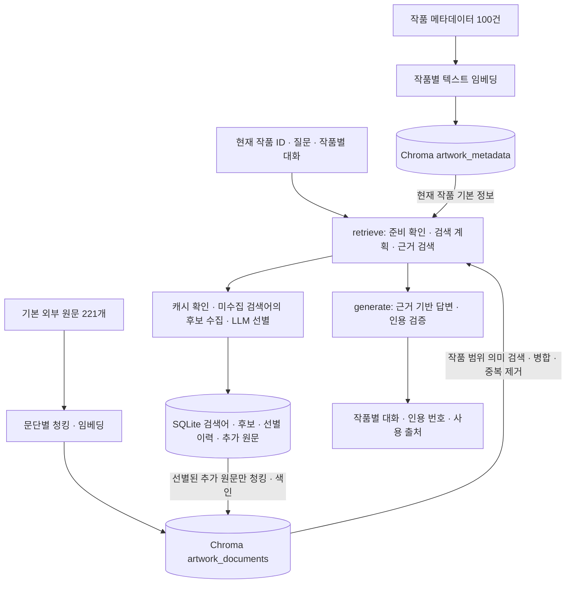
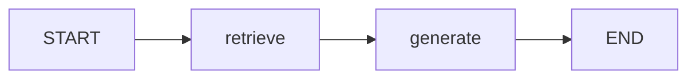

# AI Docent

## Git 주소

| 항목 | 내용 |
| --- | --- |
| 저장소 URL | |

제출 전 강사가 Member(Owner 권한)로 추가되어 있는지 저장소에서 확인합니다.

## 프로젝트 개요

따뜻한 베이지 화이트 벽에 작품을 한 점씩 전시하는 온라인 갤러리입니다.
수집한 시카고 미술관 회화 100점의 이미지·작품명·작가·제작 시기를 연결했습니다.
현재 작품의 문서를 검색해 작품·작가·시대 배경과 감상 가이드를 설명하고, 사용한 출처를 함께 제공합니다.
화면은 HTML/CSS/JavaScript, 서버는 Python/FastAPI를 사용합니다.

제출 기준별 위치: [실행 방법](#실행) · [요구사항 정의서](#요구사항-정의서) ·
[RAG 파이프라인 설계문서](#rag-파이프라인-설계문서) · [사용한 데이터](#사용한-데이터) ·
[전체 기능 설명](#전체-기능-설명)

## 요구사항 정의서

### 도메인 선택 근거와 적용 범위

미술작품은 작품·작가·제작 시기 메타데이터와 해설을 연결할 수 있고, 시카고 미술관 공개 데이터에서
회화 100점 이상과 원문을 확보할 수 있어 선택했습니다. 작가의 생애·시대 배경·작품 해석은 외부 문서 근거가 필요하므로 RAG에 적합합니다.

외부 근거가 필요한 질문 예시는 다음과 같습니다. 답변 가능한 범위는 선택한 작품과 수집 문서에 따라 다릅니다.

1. “이 작품의 색과 구도를 미술관 해설에서는 어떻게 설명하고 있어?”
2. “이 작가의 생애와 활동 배경 중 문서로 확인되는 내용을 알려줘.”
3. “이 작품 제작 당시의 사회·종교적 배경은 어떠했어?”

미술 감상 도메인으로 건강·금융 전문 조언 면책 안내는 해당 없음입니다.
의료·투자 판단을 제공하지 않으며, AI 해석의 한계와 출처 확인 필요성은 아래 RAG 설명에 명시합니다.

### 요구사항 통합표

`O`는 구현, `△`는 일부 대응·추가 확인 필요, `X`는 미구현·미작성입니다.
표는 필수 F2001~F2012, 심화 F2013~F2016, 비기능 NF2001~NF2007을 함께 정리합니다.
선택한 심화는 **F2013·F2016**이며 미선택 F2014·F2015도 상태와 사유를 남깁니다.
구현 표시는 모든 수동 검증과 제출 자료 작성이 완료됐다는 의미는 아닙니다.

| 구분 | ID | 여부 | 구현 내용·확인 근거 | 미구현·보완 사유 |
| --- | --- | --- | --- | --- |
| 필수 | F2001 | O | 작품 100건 수집·고정 ID·검색용 메타데이터·원문 연결 (`scripts/prepare_art_data.py`) | — |
| 필수 | F2002 | O | 작품별 메타데이터 임베딩·증분 색인·중복 방지 (`backend/metadata_index.py`) | — |
| 필수 | F2003 | O | 작품·질문·최근 질문에서 검색어와 질문 유형 추출 (`backend/docent.py`) | — |
| 필수 | F2004 | O | 외부 후보 수집 → LLM 선별 → 저장·색인, 검색어별 재수집 방지 (`backend/external_documents.py`) | — |
| 필수 | F2005 | O | 외부 문서 청킹·별도 컬렉션 색인 (`backend/document_index.py`) | — |
| 필수 | F2006 | O | 작품 메타데이터·외부 근거 검색·병합·중복 제거 (`backend/rag.py`) | — |
| 필수 | F2007 | O | LangGraph 검색/생성 분리·근거 기반 답변 (`backend/docent.py`) | — |
| 필수 | F2008 | O | 인용 번호·실제 사용 출처의 링크/발췌/저작자/라이선스 (`frontend/docent.js`) | — |
| 필수 | F2009 | O | 작품별 대화·히스토리·작품 전환·별도 기록 창 (`frontend/docent.js`) | — |
| 필수 | F2010 | O | 현재 작품 문서 기반 3단계 감상 가이드·출처 (`backend/guide.py`) | — |
| 필수 | F2011 | O | 자연어 조건·벡터 후보·LLM 선별·서버 조건 재검사 (`backend/discovery.py`) | — |
| 필수 | F2012 | O | 실제 진행 단계·키/색인 누락·실패/재시도 (`backend/progress.py`, `backend/readiness.py`) | — |
| 심화 · 선택 | F2013 | O | HTML/CSS/JavaScript UI·FastAPI (`frontend/`, `backend/main.py`) | 기본 Streamlit 대신 심화 스택 선택 |
| 심화 · 미선택 | F2014 | X | MMR 검색 미구현 | 현재 코사인 검색·중복 제거·문서별 상한을 사용하며 MMR은 선택하지 않음 |
| 심화 · 미선택 | F2015 | X | RAG 전후 질문 5개 이상 비교 보고서 미작성 | 비교 보고서 기능을 선택하지 않음. 아래 검색 구성 비교가 이를 대신하지 않음 |
| 심화 · 선택 | F2016 | O | 미술관·Wikipedia·OpenLearn 다중 출처 색인·유형/저작자/라이선스 보존 | — |
| 비기능 | NF2001 | △ | 실제 첫 질문·반복 질문의 처리 시간 검증 사례 보유 | 대표 질문 여러 개의 시간·환경을 정리한 최종 성능표가 필요 |
| 비기능 | NF2002 | O | 검색 계획·후보·선별 결과 영구 캐시·동일 청크 임베딩 재사용 | — |
| 비기능 | NF2003 | △ | 서버 환경변수·`.env`/캐시 Git 제외·키/프롬프트 비노출 | 제출할 최종 Git/압축 파일의 비밀정보 검사가 남음 |
| 비기능 | NF2004 | O | 입력 검증·외부 오류 원문 비노출·공개 안내/재시도 | — |
| 비기능 | NF2005 | O | 수집·색인·검색·생성·API·프론트 모듈 분리·검색 설정 파일 | — |
| 비기능 | NF2006 | O | 식별용 User-Agent·호출 간격·캐시·재시도/Retry-After | — |
| 비기능 | NF2007 | O | 출처별 라이선스·저작자·변경 내역·제3자 자료 제외 | — |

## 실행

### 준비 환경

- Windows PowerShell, **Python 3.12**. 기존 개발 환경은 Python 3.12.10입니다.
- SSAFY GMS 사용 권한이 있는 `GMS_KEY`. 채팅은 `gpt-5.4-nano`, 임베딩은 `text-embedding-3-small`을 사용합니다.
- 질문별 Wikipedia 수집용 `WIKI_CONTACT`: 본인의 이메일, HTTPS 연락 URL 또는 `User:위키계정` 중 하나입니다.
- 패키지 설치·최초 색인·AI 기능에는 네트워크가 필요합니다. 색인과 질문 처리에는 GMS 사용량이 발생합니다.
- Node.js는 JavaScript 스트림 테스트에만 필요합니다. 프론트 실행에 npm 설치나 빌드는 없습니다.

아래 명령은 이 README와 `backend/`, `frontend/`, `requirements.txt`가 있는 프로젝트 루트
`AI-Docent`에서 실행합니다. 배포된 `data/art/`와 로컬 이미지 3개를 사용하므로 기본 데이터 재수집은 필요하지 않습니다.

### 1. 가상환경·패키지 설치

```powershell
py -3.12 -m venv .venv
.\.venv\Scripts\python.exe -m pip install -r requirements.txt
```

가상환경의 Python을 직접 지정하므로 PowerShell 활성화 스크립트를 실행할 필요가 없습니다.

### 2. 환경변수 설정

기존 `.env`를 덮어쓰지 않고 예제를 복사합니다.

```powershell
if (-not (Test-Path -LiteralPath .env)) {
    Copy-Item -LiteralPath .env.example -Destination .env
}
```

`.env`를 편집해 두 값을 채웁니다. 실제 키와 연락처는 README나 소스에 입력하지 않습니다.

```dotenv
GMS_KEY=여기에_본인의_GMS_키
WIKI_CONTACT=여기에_본인의_연락처
```

키는 서버에서만 읽으며 브라우저에 전달하지 않습니다. `.env`를 변경했다면 서버를 재시작합니다.
아래 서비스 상태 조회는 키의 설정 여부를 검사하며 유효성은 실제 모델 호출의 인증 응답으로 확인합니다.
`WIKI_CONTACT`나 외부 연결의 유효성까지 미리 검사하는 것은 아닙니다.

### 3. 두 컬렉션 색인

```powershell
.\.venv\Scripts\python.exe -m scripts.index_artworks
.\.venv\Scripts\python.exe -m scripts.index_documents
```

기본 데이터·설정에서는 작품 메타데이터 **100건**, 외부 문서 **221개 → 689청크**가 준비됩니다.
고정 ID와 내용 해시로 갱신하므로 같은 입력으로 재실행해도 중복되지 않습니다. 변경이 없으면 각각
`embedded: 0, unchanged: 100`과 `embedded: 0, unchanged: 689`로 재사용합니다.
실행 중 추가 문서를 수집한 환경은 문서·청크 수가 더 많을 수 있습니다.
원문·청킹 설정을 바꾸면 외부 문서를 재색인하고, 임베딩 모델을 바꾸면 새 컬렉션명으로 두 색인을 다시 생성합니다.

### 4. 서버 실행

```powershell
.\.venv\Scripts\python.exe -m backend.main
```

[전시관](http://127.0.0.1:7777)에 접속합니다. 개발 중에는 다음 명령으로 자동 재시작을 사용할 수 있습니다.

```powershell
.\.venv\Scripts\python.exe -m uvicorn backend.main:app --reload --host 127.0.0.1 --port 7777
```

전시관·작품 조회에는 API 키나 색인이 필요하지 않습니다. 도슨트와 작품 조건 탐색에는 키와 색인이 필요합니다.
HTML을 직접 열거나 별도 정적 파일 서버로 실행하면 백엔드가 연결되지 않으므로 FastAPI 주소로 접속합니다.
이하 상세 절의 `python -m ...` 예시는 가상환경을 활성화한 터미널에서 실행하거나,
`python`을 `.\.venv\Scripts\python.exe`로 바꿔 실행합니다.

### 준비 상태·문제 해결

| 확인 주소·상황 | 확인할 내용·조치 |
| --- | --- |
| [도슨트 상태](http://127.0.0.1:7777/api/docent/status) | 키 설정·두 색인 준비 여부, 누락 항목 안내 |
| [RAG 상태](http://127.0.0.1:7777/api/rag/status) | 저장/기대 건수·문서 수·청킹 설정·실제 그래프 |
| [작품 색인 상태](http://127.0.0.1:7777/api/index/status) | 작품 메타데이터 준비 여부·건수·임베딩 모델 |
| 키 없음·인증 실패 | `.env`의 `GMS_KEY`와 사용 권한 확인 후 서버 재시작 |
| 색인 없음·데이터와 불일치 | 해당 색인 명령 재실행 |
| 외부 문서 수집 실패 | `WIKI_CONTACT`·Wikipedia 연결 확인 후 재시도. 일반 LLM 답변으로 전환하지 않음 |
| 포트 7777 사용 중 | 기존 서버를 종료한 후 실행 |

## 전체 기능 설명

필수 기능과 선택한 심화 기능의 기능명·한 줄 설명입니다. 미선택 심화는 위 통합표에서만 상태를 표시합니다.

| 구분 | ID | 기능명 | 한 줄 설명 |
| --- | --- | --- | --- |
| 필수 | F2001 | 작품 데이터 준비 | 공개 회화 100점과 작품·작가·시대 문서를 연결합니다. |
| 필수 | F2002 | 작품 메타데이터 색인 | 작품당 한 레코드를 임베딩하고 변경분만 갱신합니다. |
| 필수 | F2003 | 질문 검색어 추출 | 현재 작품과 질문 문맥을 영어 검색어·질문 유형으로 변환합니다. |
| 필수 | F2004 | 외부 문서 수집·선별 | 후보를 수집·LLM 선별·색인하고 완료한 검색어는 재사용합니다. |
| 필수 | F2005 | 문서 청킹·색인 | 외부 문서를 문단별로 분할해 별도 Vector DB 컬렉션에 저장합니다. |
| 필수 | F2006 | 작품별 근거 검색 | 현재 작품 범위의 기본 정보·외부 청크를 병합하고 중복을 제거합니다. |
| 필수 | F2007 | 문서 기반 답변 | LangGraph 검색/생성 노드를 거쳐 근거가 있는 내용만 설명합니다. |
| 필수 | F2008 | 인용·출처 확인 | 인용 번호를 눌러 원문·발췌·저작자·라이선스를 확인합니다. |
| 필수 | F2009 | 작품별 대화·기록 | 작품을 넘기면 해당 대화로 전환하고 별도 창에서 기록을 다시 봅니다. |
| 필수 | F2010 | 작품 감상 가이드 | 현재 문서로 관찰 → 배경 이해 → 다시 감상의 3단계를 안내합니다. |
| 필수 | F2011 | 자연어 작품 탐색 | 작가·연도·지역·사조 등 조건으로 작품을 찾아 해당 전시로 이동합니다. |
| 필수 | F2012 | 진행·준비 상태 안내 | 실제 처리 단계와 설정 누락·오류·재시도 안내를 표시합니다. |
| 심화 · 선택 | F2013 | 웹 전시관 UI | HTML/CSS/JavaScript와 FastAPI로 PC·모바일 전시 화면을 제공합니다. |
| 심화 · 선택 | F2016 | 다중 출처 활용 | 미술관·Wikipedia·OpenLearn 원문을 구분해 색인하고 출처 정보를 제공합니다. |

### 전시관 이용

- 헤더에 `AI Docent`만 표시합니다.
- 작품 원본 비율을 유지한 액자와 작품명·작가·제작 시기를 보여줍니다.
- 좌우 버튼, 키보드 방향키, 가로 드래그·스와이프로 작품을 이동합니다.
- 벽과 바닥이 함께 조금씩 움직이며 같은 전시 벽을 따라 걷는 느낌을 줍니다.
- 마지막 작품과 첫 작품 사이도 순환합니다. 현재 작품은 새로고침 후 복원합니다.
- 현재 작품과 앞뒤 작품의 이미지 세 개만 준비합니다.
- 운영체제의 모션 줄이기 설정에서는 이동 애니메이션을 생략합니다.
- 도슨트는 처음에 닫혀 있으며, 데스크톱에서는 오른쪽 패널, 모바일에서는 아래 패널로 열립니다.
- 질문과 입력 중인 내용은 작품별로 구분되며, 작품을 넘기면 해당 작품의 대화가 표시됩니다.
- 패널의 히스토리에서 작품별 기록을 다시 열 수 있습니다. 별도 기록 창은 작품 이미지·작가·제작 시기와 대화를 보여주며, 뒤의 전시 작품을 바꾸지 않습니다. 데스크톱에서는 창의 제목 표시줄을 드래그해 이동할 수 있습니다.
- 패널의 `작품 탐색` 탭에서 자연어 조건으로 작품을 찾습니다. 결과에는 일치 근거와 미술관 원문 링크가 표시되며, 작품을 누르면 전시 작품이 바뀌고 해당 작품의 대화로 이어집니다.
- 대화 기록은 현재 브라우저의 로컬 저장소에 보관합니다. 저장이 차단되면 현재 탭에서만 유지합니다.
- 도슨트는 `POST /api/chat/stream`으로 현재 작품 ID·질문·그 작품의 이전 대화를 보내고 실제 처리 단계와 문서에 근거한 RAG 답변을 표시합니다. 기존 `POST /api/chat`도 같은 최종 응답 형식으로 유지합니다.
- 현재 작품 정보 아래 `작품 감상 가이드`를 누르면 문서에 근거한 3단계 감상 가이드를 같은 대화 영역에 표시합니다. 가이드와 출처도 작품별 히스토리에 저장됩니다.
- 답변 대기 중 중복 전송을 막고, 실패하면 같은 질문을 다시 보낼 수 있습니다. 응답을 기다리며 작품을 넘겨도 답변은 질문했던 작품에 저장됩니다.
- 답변의 `[근거 N]`을 누르거나 아래 `출처 N개`를 펼치면 실제 인용한 문서의 원문 링크·저작자·라이선스·검색 발췌를 확인할 수 있습니다. 출처도 대화와 함께 저장하며 별도 히스토리 창에서 다시 볼 수 있습니다.
- 기존 일반 LLM 답변은 `이전 일반 AI 답변`으로 구분합니다. 새 답변은 `문서 기반`으로 표시합니다. 이미지 분석은 수행하지 않습니다.
- 이전 프론트 미리보기 기록은 보존하되 미리보기 답변은 LLM의 대화 문맥에서 제외합니다.

작품명과 작가는 검증되지 않은 번역을 추가하지 않고 수집 데이터의 표기를 사용합니다.
한국어 필드가 채워지면 한국어 표기를 우선 표시합니다.
제작 시기는 단일 연도뿐 아니라 `1577–79` 같은 원본 범위도 그대로 표시합니다.

## 사용한 데이터

기본 배포본의 메타데이터·외부 원문을 출처·건수·이용 조건별로 구분합니다.

| 구분 | 출처 | 기본 건수 | 이용 조건·보존 정보 |
| --- | --- | ---: | --- |
| 작품 메타데이터 | [시카고 미술관 API](https://api.artic.edu/docs/) | 100점 | CC0. 작품 ID·제목·작가·제작 시기·원문 URL·수집일 보존 |
| 작품 해설 | 시카고 미술관 작품별 `description` | 100문서 | CC BY 4.0. 미술관·작품명·원문·라이선스·HTML 제거 사실 보존 |
| 작가 소개 | 영어 Wikipedia | 57문서 | CC BY-SA 4.0. 기여자·원문·가능한 판본 정보·변경 내역 보존 |
| 사조·시대 소개 | 영어 Wikipedia | 14문서 | CC BY-SA 4.0. 출처·기여자·라이선스·원문 처리 내역 보존 |
| 시대 배경 선별본 | [OpenLearn / The Open University](https://www.open.edu/openlearn/) | 50문서 | CC BY-NC-SA 4.0. 비영리·동일조건, 저자·원문·선별 내역 보존, 제3자 자료 제외 |
| 작품 이미지 대체 경로 | Wikimedia Commons | 97점 | 퍼블릭 도메인/CC0 확인 파일. 동일 소장품 확인 근거·파일 원문 보존 |
| 작품 이미지 로컬 파일 | ArtheonMuseum 공개 복제본 | 3점 | CC0 확인. 작품 ID·원문 페이지·해시·크기 보존 |

외부 원문 합계는 **221문서**입니다. 작품 메타데이터 100건과 이미지 항목은 이 문서 합계에 더하지 않습니다.
실행 중 질문별 Wikipedia 추가 문서는 별도 캐시에 보관하므로 기본 배포 건수와 구분합니다.
라이선스가 다른 자료 전체에 단일 라이선스를 적용하지 않습니다. 개별 출처·저작자는 각 레코드와
[데이터 설명서](data/art/README.md), [OpenLearn 강좌별 조건](data/art/openlearn_sources.json)에서 확인합니다.

### 원문과 이미지 구성

`data/art/artworks.json`이 작품 메타데이터의 원본입니다.
`data/art/documents.json`의 해설 문서를 RAG 검색에 사용합니다.
기본 배포 문서는 기존 작품·작가·사조 설명 171개와 OpenLearn 시대 배경 선별본 50개를 합친 221개입니다.
OpenLearn은 근세 유럽 입문 19개, 네덜란드 황금시대 회화 13개, 계몽주의 18개이며,
제3자 인용문·이미지·활동용 발췌문을 제외한 저자 해설을 수집했습니다.
원문·저자·수집일·CC BY-NC-SA 4.0·변경 내역을 각 문서에 저장하고,
강좌별 이용조건과 제외 내역은 `data/art/openlearn_sources.json` 및 `openlearn_collection_report.json`에 보존합니다.
이 데이터는 시대 배경 질문의 RAG 검색에 연결되어 있습니다. 자세한 선별 기준과 비영리 이용조건은 `data/art/README.md`를 참고합니다.

미술관 IIIF 이미지 서버가 현재 환경에서 HTTP 403을 반환하므로,
`data/art/image_fallbacks.json`에 동일 소장품의 Wikimedia Commons 공개 복제본을 연결했습니다.
그림 제목만으로 대체하지 않고 다음 근거 중 하나로 일치 여부를 확인합니다.

1. 파일 출처·참고문헌에 미술관 작품 ID가 명시됨
2. 미술관명과 소장번호가 일치함
3. 파일의 작품 엔터티에 있는 Wikidata `P4610` 값이 미술관 작품 ID와 일치함

CC0/퍼블릭 도메인 파일만 사용하고, 파일 원문·라이선스·검증 방법을 함께 저장합니다.
100점 중 97점은 Commons 대체 경로를 사용합니다. 나머지 3점(Melancholia, Breakfast Still Life,
Branch of the Seine near Giverny (Mist))은 미술관 이미지 요청이 403 보안 확인 HTML을 반환하여
임베드가 실패하는 것을 확인했습니다. 미술관의 [공식 이미지 문서](https://api.artic.edu/docs/#images)는
이미지 임베드를 허용하므로 URL 형식이나 일반적인 CORS 설정 오류와 구분해야 합니다.

이 3점은 ArtheonMuseum의 공개 복제본 페이지가 동일한 미술관 작품 ID로 연결되고,
제목·작가 및 이미지의 CC0 라이선스가 일치하는지 검증했습니다. 공개 페이지에 명시된
고해상도 WebP를 `frontend/artworks/`에 저장하고, 전시관·탐색·히스토리에서 같은 서버의
`/static/artworks/` 경로를 먼저 불러옵니다. 이미지 원본 출처·미술관 원문·이용 조건·
파일 해시·크기는 `data/art/local_images.json`에 보존합니다. 이미지 파일 3개와 이 명세는
Git에 포함하며, 다른 작품으로 바꾸거나 AI 이미지로 대체하지 않습니다.
기존 원격 경로는 다음 후보로 유지합니다. 원격 이미지의 서비스 상태는 바뀔 수 있습니다.

기본 메타데이터와 이미지 대체 경로를 다시 수집하려면 실행합니다.

```powershell
python scripts/prepare_art_data.py
python scripts/prepare_image_fallbacks.py
python -m scripts.prepare_local_images
```

기본 수집·이미지 대체 경로 스크립트는 원문 응답을 `.cache/`에 저장하고 호출 간격을 지킵니다.
전체 이미지 파일을 내려받지는 않습니다. 로컬 이미지 스크립트는 검증한 3점만 저장하고,
해시가 같은 파일은 재사용합니다. 차단된 미술관 주소를 프록시하거나 보안 확인을 우회하지 않습니다.
출처별 자세한 이용 조건은 `data/art/README.md`를 참고합니다.

## 구조

```text
backend/
  main.py                 # HTML·정적 파일과 API 제공
  artworks.py             # 수집 데이터 → 공개 갤러리 메타데이터 변환
  provider.py             # 기존 GMS 모델·키 설정과 응답 텍스트 처리
  corpus.py               # 원본 문서 검증·작품 연결·시대 배경 범위
  docent.py               # LangGraph retrieve/generate 두 노드·검색어 추출·답변 인용
  guide.py                # F2010 감상 순서·단계별 근거 검증·출처 필터링
  progress.py             # F2012 요청별 실제 단계 이벤트·공개 문구·연결 중단 확인
  chat_stream.py          # 진행 상태 스트림과 기존 최종 응답·안전한 오류 전달
  readiness.py            # API 키·작품/해설 색인 누락 구분 및 준비 상태
  rag.py                  # 두 컬렉션 근거 조회·의미 검색·중복 제거·원문 발췌 병합
  document_index.py       # 외부 문서 청킹·중복 길이·별도 Chroma 컬렉션
  metadata_index.py       # 메타데이터 임베딩·Chroma 영구 저장·중복 없는 갱신
  discovery.py            # 자연어 조건 해석·벡터 후보 검색·LLM 선별·서버 조건 검사
  external_documents.py   # 질문별 Wikipedia 후보 수집·LLM 문서 선별·색인 재개
  collection_store.py     # 검색어/검색 계획/선별 이력·추가 문서·작품 연결 영구 저장
config/
  search.json             # 임베딩·두 컬렉션·청크 크기/중복 길이·Top-k 설정
frontend/
  index.html              # 헤더와 작품 전시 벽
  style.css               # 승인된 전시관 디자인
  gallery.css             # 전체 화면 배치·실제 이미지·로딩/오류 상태
  app.js                  # 작품 조회, 세 작품 순환 전시, 버튼·방향키·스와이프
  docent.css              # 접이식 도슨트·모바일 하단 패널·별도 기록 창
  docent.js               # 작품별 채팅 API 연결·대기/실패/재시도·로컬 히스토리
  chat-stream.js          # UTF-8 스트림 해석·요청별 진행/완료/오류 검사
scripts/
  prepare_art_data.py      # 작품 메타데이터·해설 수집
  prepare_image_fallbacks.py # 같은 소장품의 공개 이미지 경로 확인
  prepare_local_images.py   # 차단 영향을 받는 3점의 검증된 공개 이미지 로컬 저장
  prepare_openlearn_data.py # OpenLearn 저자 해설 선별·출처 보존·중복 없는 데이터 병합
  index_artworks.py         # python -m scripts.index_artworks: 작품당 한 레코드 색인
  index_documents.py        # python -m scripts.index_documents: 외부 문서 청크 색인
  inspect_rag.py            # 실제 컴파일된 LangGraph의 Mermaid 출력 (모델 호출 없음)
  inspect_collection.py     # F2004 검색어·선별/제외 문서·색인 상태 확인 (모델 호출 없음)
```

## API

`GET /api/artworks`는 `{"artworks": [...], "total": 100}` 형식으로 반환합니다.
각 작품에는 ID, 작품명, 작가, 제작 시기, 이미지 후보 URL, 이미지 크기,
미술관 원문, 이미지 출처와 라이선스가 포함됩니다. 키·프롬프트는 포함하지 않습니다.

데이터 파일이 없거나 읽을 수 없으면 안내 메시지와 HTTP 503을 반환합니다.
프론트는 목록 조회 실패 시 다시 불러오기를 제공하고, 이미지 실패 시 다음 후보를 시도합니다.

`POST /api/chat` 요청 예시는 다음과 같습니다.

```json
{"artwork_id":"aic:28560","question":"작가에 대해 알려줘.","history":[{"role":"user","content":"작품 이름은?"},{"role":"assistant","content":"The Bedroom입니다."}]}
```

응답은 `artwork_id`, `answer`, `mode: "rag"`, `sources`입니다. 각 출처에는 답변의 인용 번호,
문서/청크 ID, 제목·원문 URL, 발췌, 출처 유형, 저작자, 라이선스·링크, 원문 처리 내역,
수집일, 일반 시대 배경 여부가 포함됩니다. 작품은 서버 카탈로그에서
조회하며, 알 수 없는 작품은 404, 공백 질문·2000자 초과 질문·20개 초과 대화·system 역할은 422로 거절합니다.
연결 실패·시간 초과·요청 제한은 안내 문구로 응답하며 외부 API의 원문 오류나 비밀 값을 노출하지 않습니다.
대화 기록의 영구 저장소는 아직 브라우저이며 서버 DB는 사용하지 않습니다.

`POST /api/chat`에 `feature: "guide"`를 추가하면 현재 작품의 감상 가이드를 요청합니다.
생략하거나 `"chat"`이면 기존 일반 질문으로 처리하며 응답 형식은 동일합니다.

```json
{"artwork_id":"aic:28560","question":"작품 감상 가이드를 만들어줘.","history":[],"feature":"guide"}
```

`GET /api/config`는 미술 도메인, `chat_mode: "rag"`, 설정 여부, `rag_enabled: true`,
`retrieval: "artwork_scoped_chroma"`, `pipeline: "langgraph_retrieve_generate"`를 반환합니다.
작품 탐색 방식은 별도 `artwork_search: "chroma_semantic_then_llm_filter"`로 반환합니다.
`GET /api/rag/status`는 두 컬렉션의 준비 상태·저장/기대 건수·청킹 설정·실제 LangGraph 구조를 반환합니다.
API의 채팅 요청/응답 구조와 기존 프론트·출처 클릭·히스토리 저장 방식은 유지합니다.

## 작품 메타데이터 색인과 조건 탐색 (F2002 / F2011)

작품 메타데이터는 [Chroma PersistentClient](https://docs.trychroma.com/reference/python/client)의
`artwork_metadata` 컬렉션에 작품당 한 레코드로 저장합니다. ID는 원래 작품 ID(`aic:28560` 등)를
유지하며, `search_text`와 미술관의 이미지 대체 설명을 하나의 텍스트로 임베딩합니다.
문서 본문은 이 컬렉션에 섞지 않습니다. 제목·작가·제작 연도·원문 출처·내용 해시를 함께 저장합니다.

```powershell
python -m scripts.index_artworks
```

현재 100점 기준 최초 실행은 `count: 100, embedded: 100`, 같은 데이터로 재실행하면
`count: 100, embedded: 0, unchanged: 100`을 반환합니다. 고정 ID로 upsert하여 중복을 방지하고,
변경된 항목만 다시 임베딩하며 삭제된 작품의 색인도 정리합니다. 색인 중 실패하거나 데이터가
바뀌면 검색을 중단하고 재색인을 안내합니다. `GET /api/index/status`로 준비 상태·저장 건수·
기대 건수·임베딩 모델을 확인할 수 있습니다. DB는 `.cache/chroma`에 저장되므로 Git에 포함되지 않습니다.

`config/search.json`에서 저장 경로, 컬렉션명, 임베딩 모델, 배치 크기, 후보 수(기본 30),
최대 결과 수(기본 8)를 조정합니다. 임베딩 모델을 바꾸면 새 컬렉션명을 지정해 재색인합니다.

`POST /api/artworks/search` 요청:

```json
{"query":"19세기 프랑스 인상주의 풍경화를 찾아줘.","limit":8}
```

응답은 `query`, `results`, `total`이며 결과마다 공개 작품 정보와 한국어 `reason`을 제공합니다.
서버는 자연어 조건을 영어 의미 검색어와 연도·작가·지역·사조 필터로 변환하고,
Chroma에서 후보를 검색한 뒤 LLM으로 원래 조건 전체를 만족하는 작품만 선별합니다.
서버가 명시적 필터와 후보 ID를 다시 검사하며, 후보 밖의 작품 ID를 생성하면 오류로 처리합니다.
선별 결과가 없을 때 다른 작품을 임의로 채우지 않습니다. 키·네트워크·모델 오류는 재시도 안내로 표시합니다.

제작 시기는 기록된 연도 범위 전체가 조건 안에 들어가는 작품만 포함합니다. 세기는 1801–1900년처럼
계산하고, `1800년대`는 1800–1899년으로 해석합니다. 지역은 미술관의 `place_of_origin`을 기준으로
확인하며, 작가 국적이나 실제 제작 장소를 임의로 추정하지 않습니다. 인상주의와 후기 인상주의는
서로 다른 사조로 검사합니다. 주제·분위기 같은 조건은 저장된 태그·대체 설명으로 확인 가능한 범위에서
선별하므로 이미지 자체를 분석한 결과는 아닙니다. 후보 수에 따라 일치하는 작품 일부가 빠질 수 있습니다.

## RAG 파이프라인 설계문서

전체 구성은 기본 데이터의 두 컬렉션 색인과 질문 처리 경로로 나뉩니다.
실제 LangGraph 노드는 `retrieve`, `generate` 두 개이며, 아래 수집·선별은 `retrieve` 안의 처리입니다.



이미 완료한 검색·선별은 캐시를 사용하며, 감상 가이드는 외부 수집 없이 기존 문서를 검색합니다.
모델은 SSAFY GMS의 `gpt-5.4-nano`, 임베딩은 `text-embedding-3-small`이며 설정은
`config/search.json`에서 관리합니다. 청킹·검색 설정, 세 프롬프트, 출처·근거 부족 처리,
재수집 방지·실패 복구는 이 절과 이어지는 RAG 답변 흐름·F2004 절에 정리합니다.

### 외부 문서 색인 및 LangGraph (F2005 / F2006 / F2007)

| 저장 위치 | 역할 | 기본 데이터·설정 기준 |
| --- | --- | --- |
| `data/art/artworks.json` | 작품 기본 정보·검색 텍스트·원문 연결 | 작품 100건 |
| `data/art/documents.json` | 검토한 미술관·Wikipedia·OpenLearn 원문 | 문서 221개 |
| `.cache/chroma` → `artwork_metadata` | 작품 검색용 메타데이터 임베딩 | 레코드 100건 |
| `.cache/chroma` → `artwork_documents` | 외부 원문의 문단별 청크 임베딩 | 청크 689개 (`1000/200`) |
| `.cache/collection/journal.sqlite3` | 검색 계획·후보·선별 이력·추가 원문·작품 연결 | 실행 중 생성 |
| 브라우저 로컬 저장소 | 작품별 대화·가이드·출처·입력 초안 | 브라우저별 관리 |

**기본 배포 데이터와 실행 중 수집분은 다릅니다.** 2026-10-22 검증 환경은 추가 수집분을 포함해
224문서·695청크였습니다. 새 환경은 기본 221문서·689청크에서 시작하며 질문에 따라 달라집니다.
추가 수집은 `data/art/`를 덮어쓰지 않습니다. 수집 캐시를 삭제하면 추가 원문·검색 이력이 사라지고
재수집할 수 있으며, 달라진 원문 목록에 맞춰 문서 색인도 다시 준비해야 합니다.

`artwork_metadata`에는 작품 100점의 기본 정보가, `artwork_documents`에는 기본 문서와
실행 중 선별·추가한 외부 문서의 청크가 저장됩니다. 두 컬렉션은 같은 GMS 임베딩 모델과 코사인 거리를 사용합니다.
배포된 기본 문서 221개는 기본 설정으로 외부 청크 **689개**가 저장되며, 동일한 입력으로 다시 실행하면
`embedded: 0, unchanged: 689`로 재사용합니다. 원문 문서와 작품 연결 정보는 수정하지 않습니다.

```powershell
python -m scripts.index_artworks
python -m scripts.index_documents
python -m scripts.inspect_rag
```

실제 실행 경로는 다음 두 노드입니다. 검색어 추출·수집·선별·색인·근거 검색은 `retrieve` 내부에서,
답변 또는 감상 가이드 생성은 `generate`에서 수행합니다. `inspect_rag`는 설명용 가상 그래프가 아니라 컴파일된
객체의 구조를 출력합니다. 외부 이미지 렌더링 서비스나 모델을 호출하지 않습니다.



외부 청크 ID는 `<문서 ID>:p<문단 순번>:c<문단 내 시작 위치>`입니다. 한 작가·사조 문서를
여러 작품이 공유해도 같은 원문 청크는 한 번만 저장하고, 문서 ID 필터로 작품 범위를 제한합니다.
청크에는 원문 제목·URL·문서 ID·관련 작품 ID·출처 유형·라이선스·저작자·수집일·문단/원문 위치를 저장합니다.
OpenLearn은 보존된 `passages` 각각 안에서만 분할하여 제외된 인용문이나 활동을 다시 이어 붙이지 않습니다.

`config/search.json`의 RAG 설정:

| 설정 | 기본값 | 역할 |
| --- | ---: | --- |
| `document_chunk_size` | 1000 | 청크 최대 글자 수. 프론트 발췌 제한에 맞춰 200–1400자 허용 |
| `document_chunk_overlap` | 200 | 같은 원문 문단 내 연속 청크가 공유하는 글자 수. 크기보다 작아야 함 |
| `retrieval_top_k` | 6 | 메타데이터 1건 외에 선택할 외부 청크 수의 상한 |
| `retrieval_max_sources` | 5 | 기존 출처 UI가 지원하는 근거 수의 상한. 메타데이터 포함 |
| `retrieval_chunks_per_source` | 2 | 문서당 청크 상한. 기존 발췌·히스토리 형식과 호환 |
| `retrieval_max_distance` | 0.9 | 필수 작품 해설 외 후보의 코사인 거리 상한 |

1000자와 200자 중복은 문맥을 유지하면서 프롬프트와 발췌 길이를 제한하기 위한 초기값입니다.
품질 최적값이라고 측정한 것은 아닙니다. 크기·중복 길이를 바꾸면 재색인이 필요하며,
Top-k·거리·출처 수만 바꾸면 다음 요청부터 적용됩니다. 자동 테스트는 청킹 설정 변경에 따른
저장 건수 변화, 재색인 실패 후 복구, Top-k에 따른 근거 변화, 중복 제거와 실제 노드 실행 순서를 검사합니다.

기본 원문 221개를 분할만 비교하면 `1000/200`은 689개, `1000/0`은 684개, `600/100`은 860개입니다.
기본 원문만 색인하면 `1000/200`에서 689개이며, 실행 중 추가 원문이 있으면 증가합니다. 실제 임베딩 검색으로 같은 침실 질문을
비교했을 때 Top-k=1은 메타데이터 1건+외부 청크 1개, Top-k=6은 메타데이터 1건+외부 청크 6개
(전체 출처 4개)를 구성했습니다. 이는 근거 구성 비교이며 답변 품질 우열 평가를 대신하지 않습니다.

원문·청킹 설정·모델과 색인의 서명이 다르거나 색인이 비어 있으면 503으로 재색인을 안내합니다.
API 요청 중에는 선별로 추가·변경된 문서 청크만 임베딩합니다. 중단된 색인은 `building` 상태로 차단하고,
명령을 다시 실행하면 저장된 동일 청크를 재사용합니다. DB는 `.cache/chroma`에 있어 Git에서 제외됩니다.

## RAG 답변 흐름

근거가 필요한 질문 예시는 “이 작품의 색과 구도에서 주목할 부분을 설명해줘”,
“작가의 생애 중 문서로 확인되는 배경을 알려줘”, “제작 당시의 사회·종교적 배경을 설명해줘”입니다.
작품과 문서 범위에 따라 답할 수 있는 내용이 다르며 이미지 자체를 분석하지 않습니다.

### 세 프롬프트의 역할과 응답 형식

| 단계 | 역할·입력 | 모델 응답·서버 처리 |
| --- | --- | --- |
| 1. 검색어 추출 | 미술사 전문가 역할, 작품·질문·최근 질문 | `{"keywords":"English terms","focus":"artist","external_queries":["query"]}`. `focus`는 `artwork`, `artist`, `period` 중 하나. 검증 후 검색 계획 캐시 |
| 2. 후보 선별 | 미술관 연구 사서 역할, 작품·질문·후보 제목/URL/요약 | `{"selected":[{"id":"후보 ID","kind":"artist","reason":"선별 이유"}]}`. `kind`는 `artwork`, `artist`, `style`, `historical_context` 중 하나. ID·개수 검증 후 선택/제외 이력 저장 |
| 3. 답변 생성 | 한국어 도슨트 역할, 현재 작품·근거 발췌·대화 | `[근거 N]`을 붙인 평문. 인용 번호를 검증하고 실제 사용한 출처만 반환 |

감상 가이드는 세 번째 단계에서 전용 JSON을 생성하며 아래 F2010 절의 방식으로 검증합니다.
질문·이전 대화·수집 문서의 지시사항은 시스템 지침을 바꿀 수 없는 입력 데이터로 취급합니다.

### 요청 처리 순서

1. `retrieve`가 현재 작품 ID와 두 컬렉션의 준비 상태를 확인합니다. 클라이언트가 작품 정보를 임의로 바꿀 수 없습니다. 해당 작품의 메타데이터 청크는 항상 근거 1번으로 포함합니다.
2. `retrieve` 안에서 기존 GMS 모델이 한국어 질문과 최근 사용자 질문 두 개를 영어 의미 검색어·외부 검색어·질문 유형(작품·작가·시대)으로 바꿉니다. 같은 질문·문맥의 검색 계획은 영구 캐시합니다. 이전 답변은 사실의 근거로 쓰지 않습니다.
3. F2004 수집·선별 단계를 실행하고 새 문서를 외부 컬렉션에 반영한 뒤 코사인 의미 유사도로 검색합니다. 현재 작품의 미술관 해설, 연결된 작가·사조 문서, 해당 작품·질문 유형에 선별된 추가 문서로 범위를 제한합니다. 시대 질문에는 OpenLearn 후보도 추가합니다.
4. OpenLearn은 근세 유럽 1500–1780년, 계몽주의 1700–1830년, 네덜란드 회화 1600–1700년 및 네덜란드 관련 메타데이터로 후보를 제한합니다. 이는 검색 범위를 정하는 규칙이며 개별 작품과의 직접적인 인과관계를 입증하지 않습니다. 19세기 고흐 작품에 17세기 네덜란드 배경을 자동으로 붙이지 않습니다.
5. 작품 해설의 가장 가까운 청크를 우선 넣고, 질문 유형에 맞는 작가·사조·일반 시대 배경 후보와 전체 유사도 결과를 병합합니다. 같은 청크 ID와 같은 내용은 제거하고 문서당 청크·전체 출처 수를 제한합니다. 같은 문단의 겹친 발췌는 합치고, 떨어진 발췌 사이에는 `[…]`를 표시합니다.
6. `generate`가 준비된 근거만 받아 한국어 답변과 인용 번호를 만듭니다. 작품 메타데이터와 외부 문서를 구분하며, OpenLearn을 특정 작품의 제작 동기를 입증하는 자료로 단정하지 않습니다. 모델의 일반 지식으로 자동 전환하지 않습니다.
7. 답변에 실제 인용한 출처만 반환합니다. 존재하지 않는 번호는 오류로 처리하고, 인용 근거 없이 생성된 답변은 문서에 근거가 부족하다는 고정 안내로 바꿉니다. 노드 사이 상태는 요청마다 새로 만들고 공유 체크포인트를 사용하지 않아 작품별 대화가 섞이지 않습니다.

채팅과 작품 조건 탐색 모두 임베딩·ChromaDB를 사용하며, 기존 BM25 경로는 제거했습니다.
기존 `.env`의 GMS를 재사용합니다. 새 질문에는 검색어 추출·문서 선별·답변 생성의 세 프롬프트를 사용하고,
캐시된 검색 계획·선별 결과는 모델 호출 없이 재사용합니다. 의미 검색어 임베딩과 새 문서 임베딩도 호출합니다.
동일한 검색어 임베딩은 서버 프로세스 내 캐시로 재사용합니다. 문서 범위를 벗어난 상세 질문에는
충분히 답하지 못할 수 있고, 인용이 있어도 AI 해설의 해석은 원문과 대조할 수 있습니다.
새 외부 문서의 검색·후보 선별·색인은 아래 F2004 흐름으로 연결되어 있습니다.

OpenLearn 출처에는 비영리·동일조건변경허락 조건을 유지합니다. 출처 패널에서 저작자·원문·라이선스·선별 내역과 AI 한국어 요약 사실을 확인할 수 있습니다.

## 질문별 외부 문서 수집·선별 (F2003 / F2004)

실행 중 문서는 `.cache/collection/journal.sqlite3`에 저장하며, 기존 `data/art/`의 검토된 원문은
덮어쓰지 않습니다. 서버가 시작되거나 `index_documents`를 실행할 때도 수집된 추가 문서를 함께 읽습니다.
DB와 벡터 저장소는 Git에서 제외됩니다. 이 캐시를 삭제하면 수집 이력이 사라지므로 다음 질문에 다시 수집합니다.
추가 문서가 수집되면 전체 문서·청크 수는 기본 221개·689개보다 늘어납니다.

1. **프롬프트 1 — 검색어 추출:** 미술사 전문가 역할로 현재 작품·질문·최근 질문을 받아
   `keywords`, `focus`, `external_queries` JSON을 생성합니다. 서버가 현재 작품명+작가 검색어를
   반드시 추가하므로 모델이 작품 자체를 검색에서 빠뜨릴 수 없습니다.
2. **후보 수집:** 영어 Wikipedia의 [MediaWiki Search API](https://www.mediawiki.org/wiki/API:Search)로
   검색합니다. [TextExtracts](https://www.mediawiki.org/wiki/Extension:TextExtracts)의 원문 도입부,
   정식 URL, 페이지/리비전 ID, 수집일, 저작자, CC BY-SA 4.0 이용조건을 보관합니다.
   제목·요약은 선별 프롬프트 입력이며 원문을 모델이 작성하거나 보충하지 않습니다.
3. **프롬프트 2 — 후보 문서 선별:** 현재 작품·질문과 후보 제목·URL·요약을 받아
   `selected: [{id, kind, reason}]` JSON을 생성합니다. 후보 밖 ID·중복 ID·개수 초과·잘못된 형식은
   거절합니다. 최소 길이 미달 문서는 제외하되 **해당 작품의 미술관 원문은 모든 제외 규칙보다 우선**합니다.
   후보 전체, 선별 목록/이유, 제외 목록/이유를 저장합니다. 작품 탐색용 후보 선별과는 별도 단계입니다.
4. **색인·검색:** 선별한 원문만 추가 문서 목록에 게시하고 기존 외부 컬렉션에 청킹·upsert합니다.
   선택 문서는 작품 ID와 질문 유형에 연결하며 다른 작품에 자동 연결하지 않습니다. 여러 작품이
   같은 페이지를 선택하면 같은 문서 ID를 공유합니다. 기존 미술관/Wikipedia/OpenLearn 문서는 유지됩니다.
5. **프롬프트 3 — 답변 생성:** 앞선 단계가 완료된 뒤 두 컬렉션에서 검색한 근거만으로 답합니다.
   응답 API와 프론트는 유지하며 새 출처도 기존 출처 펼치기·저작자·라이선스·원문 발췌로 확인합니다.

검색어는 Unicode NFKC·대소문자·공백을 정규화해 **작품 간에도 검색 결과를 재사용**합니다.
결과가 0건인 검색도 완료로 저장합니다. 같은 질문·문맥은 검색어 추출 결과까지 보존하여 재시작 후에도
검색어가 달라져 재수집되는 일을 막습니다. 선별은 작품·질문·질문 유형·검색어 묶음별로 캐시합니다.
성공한 후보 검색은 즉시 저장하므로 이후 검색/선별이 실패해도 해당 검색어는 다시 호출하지 않습니다.
실패한 검색 자체는 완료로 기록하지 않아 재시도할 수 있습니다. 임베딩 실패 시 선별 결과와 pending 상태를
남겨 다음 요청에서 검색·선별 없이 색인을 재개합니다. 같은 캐시를 사용하는 스레드/워커는 파일 잠금으로
수집·색인·검색을 직렬화하여 중복 수집이나 불완전한 색인 조회를 막습니다.

`config/search.json`의 추가 설정:

| 설정 | 기본값 | 의미 |
| --- | ---: | --- |
| `collection_cache_directory` | `.cache/collection` | 검색 계획·검색어·후보·선별 이력·추가 원문 저장 경로 |
| `external_queries` | 2 | 추출 검색어 상한. 작품 자체 검색어는 별도 추가 |
| `external_candidates_per_query` | 4 | 새 검색어당 후보 상한. 이미 수집한 검색어에는 재적용하지 않음 |
| `external_max_selected` | 3 | 새 질문에 선별할 선택 문서 상한. 필수 작품 원문은 별도 |
| `external_min_chars` | 300 | 선택 문서의 최소 본문 길이. 필수 작품 원문에는 적용하지 않음 |

실제 외부 호출에는 `.env`의 `WIKI_CONTACT`가 필요합니다. 이메일·https 연락 URL·`User:위키계정` 중
하나를 사용하며 [Wikimedia 식별 정책](https://foundation.wikimedia.org/wiki/Policy:Wikimedia_Foundation_User-Agent_Policy)을
따릅니다. 외부 요청은 순차 실행하고 최소 1.1초 간격·일시 오류 재시도·Retry-After를 적용합니다.
긴 대기 요청은 재시도 시점을 당기지 않고 수집 오류를 안내합니다. 검색/선별이 실패하면 현재 요청은
일반 지식 답변으로 전환하지 않습니다. 첫 질문은 외부 수집·선별·임베딩 때문에 반복 질문보다 느릴 수 있습니다.

수집 증빙 확인 (네트워크/모델 호출 없음):

```powershell
python -m scripts.inspect_collection --artwork-id aic:28560 --limit 5
```

검색어와 후보 ID, 실제 선별/제외 문서와 이유, 강제 포함된 작품 원문, 현재 색인 건수를 출력합니다.
출처는 영어 Wikipedia 도입부와 기존 검토 문서로 제한하므로 웹 전체를 검색하는 서비스는 아닙니다.

실제 GMS·Wikipedia 연결 검증에서는 「The Bedroom」을 선택하고 반 고흐와 테오의 서신에 대해
질문했습니다. 기존 미술관 원문과 작가 문서는 유지하고 「The Letters of Vincent van Gogh」를
추가 선별해 **해당 검증 당시** 전체 222문서·691청크가 되었습니다. 실제 답변에 새 문서가 인용되고 브라우저의 기존
출처 영역에 원문 링크·저작자·라이선스가 표시되는 것을 확인했습니다. 같은 질문·문맥을 다시 보낼 때
검색어 추출·외부 검색·후보 선별이 호출되면 실패하도록 경계를 막아도 HTTP 200으로 답했습니다.
이 사례는 최초 약 20.64초, 반복 약 1.75초였으며 모델 상태와 질문에 따라 시간은 달라집니다.
재색인 결과는 `count: 691, embedded: 0, unchanged: 691`로 중복·반복 임베딩이 없었습니다.

## 작품 감상 가이드 (F2010)

도슨트 패널의 기존 작품 정보 아래 같은 베이지 계열 버튼을 하나 추가했습니다. 별도 화면이나
모달 없이 기존 대화와 출처 영역을 재사용하며 데스크톱의 우측 패널·모바일 하단 패널을 유지합니다.
작품 설명을 읽는 것에서 한 걸음 더 나아가 관람객이 **관찰 → 배경 이해 → 다시 감상**하는 순서로
작품을 만날 수 있도록 설계한 미술 도메인 특화 기능입니다.

가이드 요청도 실제 LangGraph `retrieve → generate`를 실행합니다. 검색에서는 현재 작품의
메타데이터·미술관 해설을 항상 포함하고 작가·사조·해당 시기/지역에 맞는 배경 자료와 현재 작품에
선별된 추가 문서를 검색합니다. 작품별 범위와 기존 Top-k·중복 제거·문서별 상한은 유지합니다.
가이드 생성 시 새 웹 문서를 수집하지 않으며, 이전 대화와 사용자의 입력 중인 내용도 가이드의
사실 근거로 사용하지 않습니다. 일반 질문의 F2004 수집 경로는 그대로 유지됩니다.

전용 생성 프롬프트는 `look`, `context`, `reflect` 세 필드를 가진 JSON을 반환합니다. 각 필드는
`text`와 `citations` 배열로 구성됩니다. 서버가 고정된 단계 제목과 `[근거 N]`을 조합합니다.

1. **먼저 바라보기:** 문서에 명시된 대상·색·구도 중 주목할 부분을 제안합니다.
2. **알고 보면 좋은 이야기:** 작품 해설을 우선하여 작가·사조·배경을 설명합니다.
3. **다시 바라보기:** 앞서 확인한 특징을 바탕으로 관람객 자신의 감상을 묻습니다.

실제 이미지 분석은 수행하지 않습니다. 문서에 없는 시각적 세부사항·상징·제작 의도는 생성하지
않도록 지시하고, 개인의 감상 질문은 정답이나 작가의 의도로 단정하지 않습니다. 일반 배경 자료는
작품의 직접적 제작 동기를 입증하는 근거와 구분합니다. 각 단계는 해당 단계에서 사용한 근거를
표시하며, 실제 인용한 출처만 기존 출처 펼치기에 남깁니다. 허용되지 않은 번호·중복 번호·임의 링크·
잘못된 JSON은 거절합니다. 근거가 부족한 단계는 안내 문구로 대체하고, 모두 부족하면 가이드를
만들 근거가 부족하다고 명시합니다. 이는 출처 연결 검증이며 모델 해석의 사실 정확성을 완전히 보장하는 것은 아닙니다.

가이드는 `도슨트 · 감상 가이드`로 표시하고 작품별로 저장합니다. 생성 중에는 중복 요청을 막고,
도중에 작품을 넘겨도 응답은 요청한 작품에 저장합니다. 실패 시 기존 재시도를 제공하며 작성 중인
일반 질문은 유지합니다. 새로고침 후와 별도 히스토리 창에서도 가이드·출처를 다시 열 수 있습니다.

F2010 구현 당시 검증: 자동 테스트 66개가 통과했습니다. 이후 전체 테스트 건수는 아래 F2012 절에 정리합니다.
실제 GMS로 반 고흐 「The Bedroom」과 쇠라
「A Sunday on La Grande Jatte」의 3단계 가이드·인용을 확인했고, 가이드 전후 문서/청크 수는
222개/691개로 동일했습니다. 브라우저에서는 생성 중 작품 전환, 이전 작품 기록 창에서 가이드
확인, 작성 중인 질문 유지, 새로고침 후 가이드 유형·출처 복원, 인용 번호 클릭을 확인했습니다.
390px 모바일 화면에서도 가로 넘침 없이 기존 하단 패널을 유지했습니다.

## 진행 상태 및 준비 안내 (F2012)

기존 베이지 도슨트 패널·메시지·재시도·출처 UI를 유지합니다. 질문 아래 작은 진행 문구를
표시하고, 문서 준비가 끝나면 준비한 문서 제목을 함께 보여줍니다. 단계가 바뀔 때 이전 출처
펼치기를 닫거나 사용자가 읽고 있는 위치를 초기화하지 않습니다. 맨 아래에서 기다리고 있을 때만
늘어난 상태 영역을 따라갑니다. 진행 이벤트는 작품별 요청에 연결되므로 작품을 넘기거나 기록 창을
열어도 다른 작품의 상태가 섞이지 않습니다.

- 일반 질문: 준비 확인 → 검색어 추출/저장 검색어 재사용 → 외부 후보 수집/수집본 재사용 →
  LLM 문서 선별/선별 결과 재사용 → 필요 시 색인 → 문서 준비 완료·제목 → 근거 검색 → 답변 생성 → 출처 확인.
- 감상 가이드: 준비 확인 → 기존 작품 문서 검색 → 가이드 생성·참고 문서 제목 → 출처 확인.
  실제로 하지 않는 외부 수집을 표시하지 않습니다.
- 중단된 색인이 있으면 색인 마무리 단계를 표시합니다. 이미 수집한 검색어·선별 이력의 재사용은
  수집 중이라고 표현하지 않습니다. 요청 종료 전 연결이 끊기면 성공 답변을 만들지 않고 재시도를 제공합니다.

`POST /api/chat/stream`은 같은 요청 모델을 받으며 UTF-8 NDJSON 프레임을 순서대로 보냅니다.
`progress`는 공개 단계·문구·최대 4개 문서 제목·검색어 처리 순번만 포함합니다. 내부 검색어,
모델 프롬프트, API 오류 원문이나 키는 보내지 않습니다. `result.data`는 기존 `/api/chat`의
`artwork_id`, `answer`, `mode`, `sources` 응답과 같습니다. 스트림을 연 후의 실패는
`error` 프레임의 `status`·안내 `detail`로 전달합니다. 입력 검증 오류는 스트림 전에 HTTP 422로
거절합니다. 오래 걸리는 단계의 연결 유지 프레임은 진행 단계로 표시하지 않습니다.
상태는 타이머로 꾸미지 않고 실제 수집·선별·색인·검색·생성 코드에서 발생합니다.

패널을 열거나 요청이 실패하면 `GET /api/docent/status`로 준비 상태를 확인합니다. 이 조회는
모델이나 외부 API를 호출하지 않습니다. 누락 항목은 작품 정보 아래 같은 색상·서체의 안내로만 표시합니다.

| 상태 | 안내 |
| --- | --- |
| GMS 키 없음 | 서버 `.env`의 `GMS_KEY` 설정과 서버 재시작 안내 |
| 키 인증 실패 | `GMS_KEY`와 사용 권한 확인 안내 |
| 작품 메타데이터 색인 없음/불일치 | `python -m scripts.index_artworks` 실행 안내 |
| 해설 문서 색인 없음/불일치 | `python -m scripts.index_documents` 실행 안내 |

키를 제거했을 때 캐시된 모델/임베딩 클라이언트 때문에 누락이 가려지지 않도록 매번 설정 여부를
확인합니다. 서비스 상태 조회는 키가 설정되어 있는지만 확인하며 유효성은 실제 모델 호출의 인증 오류로
구분합니다. 원래 키·데이터를 지우지 않고 별도 빈 저장소·키 없는 테스트 서버에서도 누락 안내를 확인했습니다.

검증 명령:

```powershell
python -m unittest discover -s tests -q
node --test tests/test_chat_stream.cjs
```

직전 F2012 구현 검증에서 Python 테스트 75개와 스트림 처리 테스트 6개가 통과했습니다.
이 README 정리는 문서 변경이며 위 수치는 해당 구현 검증 당시의 기록입니다. 한글 UTF-8 바이트 경계 분할,
연결 중단, 다른 작품 응답 차단, 요청별 상태 격리, 실제 빈 색인/키 누락, 오류 원문 비노출,
새 수집과 캐시 재사용의 단계 차이를 확인합니다. 실제 서버에서도 답변 전에 진행 프레임이
도착하고, 캐시 요청이 재수집 없이 완료되며 최종 출처 표시가 유지되는 것을 확인했습니다.

유료 모델 호출 없이 API 계약·검색 범위·인용 처리를 확인하는 테스트:

```powershell
python -m unittest discover -s tests -v
```

테스트는 외부 모델 호출을 대체하고
임시 로컬 저장소를 사용하므로 실제 GMS 답변의 품질이나 모든 원문의 사실 정확성까지 검증하지는 않습니다.

## 제출 전 준비

- 요구사항별 실제 결과·증빙 위치, 청킹/Top-k 비교, 대표 질문의 원문 대조·처리 시간을 정리합니다.
- 진행 상태·근거 부족·키/색인 누락·가이드·히스토리 등의 화면 증빙과 셀프·상호 체크리스트를 준비합니다.
- 새 환경에서 설치 → 기본 색인 → 실행 → 질문을 재현하고, 기본 데이터와 추가 수집분을 구분합니다.
- 새 모듈·설정·기본 데이터·로컬 이미지 3개·`.env.example`의 Git/압축 포함 여부를 확인합니다.
- `.env`, `.venv`, `.cache`는 제외하고 필요한 검증 자료만 별도로 정리합니다. 포함 파일의 비밀정보를 확인합니다.

추가 원문·작품 연결·수집 이력은 `.cache/collection`에 있으므로 기본 배포 데이터만으로 현재 환경의
224문서·695청크가 그대로 복원되지는 않습니다. 동일 수집분이 필요하다면 출처·이용조건을 검토한
별도 자료를 준비해야 합니다. 제외 대상 OpenLearn 원문도 있는 `.cache` 전체를 제출하지 않습니다.
